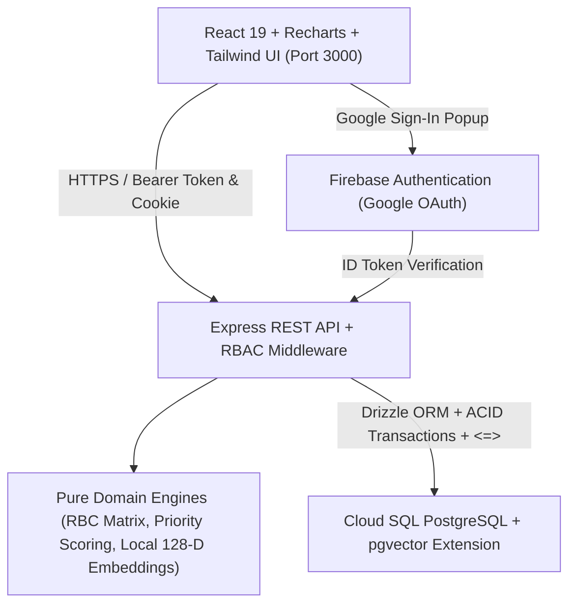

# BloodLink System Architecture

## Key Architectural Guarantees

1. **ACID Atomic Inventory Allocation**: `POST /api/matching/:requestId/allocate` executes inside `db.transaction`, guarding against negative inventory (`unitsAvailable >= unitsToAllocate`) and expired batches (`expiryDate >= CURRENT_DATE`) before committing `blood_inventory`, `blood_requests`, `inventory_transactions`, `donor_matches`, and `request_status_history` atomically.
2. **Semantic Search Isolation**: `pgvector` (`vector(128)`) cosine distance (`<=>`) retrieves semantically similar historical requests for clinical context only—never overriding RBC compatibility, inventory expiry, or authorized staff verification.
3. **RBAC & Donor Privacy**: Unauthenticated callers receive `401`. `STAFF` accounts are restricted to managing inventory at their assigned `blood_bank_id` and see masked contact PII (`***-****-3301`) for donors outside their facility.
